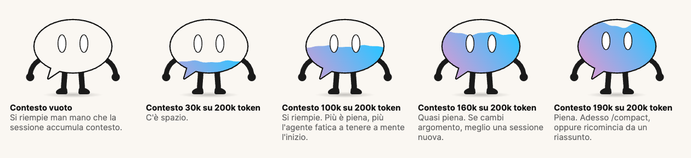

# bubble-contesto

Un **mod** di Claude Code: un pannello con la bubble AI, MAX che si riempie con il contesto
della sessione.



Il contesto è la cosa più importante che non si vede: più la sessione lo accumula, più
l'agente fatica a tenere a mente l'inizio. Questo mod lo rende visibile. Una bubble senza
contesto è solo contorno; a ogni risposta il liquido sale, sopra il 70% sciaborda, al 90%
la bubble guarda in alto e il pannello propone `/compact`. Dopo la compattazione si svuota.

La bubble è piena a **200k token**, o prima se la finestra del modello è più piccola: con
le finestre da un milione la qualità cala molto prima di riempirle.

## Dove funziona

I mod sono una funzione di **Claude Code**, in early access.

| Dove | Cosa si vede |
|---|---|
| Claude Desktop, tab **Code** | la bubble animata |
| Terminale | una barra di testo con lo stesso consiglio |
| Estensione VS Code | per ora niente pannello: `/bubble` risponde in testo ([#99045](https://github.com/anthropics/claude-code/issues/99045)) |
| Chat e Cowork di Claude Desktop | niente: i mod non ci arrivano |

## Installazione

Come plugin, da questo repository:

```bash
claude plugin marketplace add maxturazzini/bubble-contesto
claude plugin install bubble-contesto@bubble-contesto
```

Oppure da una copia locale, per una sessione sola:

```bash
git clone https://github.com/maxturazzini/bubble-contesto
claude --plugin-dir ./bubble-contesto
```

Per averla in ogni sessione, compreso il tab Code di Claude Desktop, la cartella va in
`CLAUDE_CODE_PLUGIN_DIRS` (per Desktop su macOS: `launchctl setenv`, poi riavvio dell'app).

In Desktop il mod si carica al primo messaggio della sessione. `/bubble` accende e spegne
il pannello, e se lo spegni se lo ricorda anche nelle sessioni dopo.

## Com'è fatto

| File | Cosa contiene |
|---|---|
| `hooks/register.tsx` | gli eventi: misura del contesto, `/compact`, il comando, il disegno del pannello |
| `hooks/bubble.ts` | la bubble in SVG con animazione SMIL, la scala, i testi |
| `types/index.d.ts` | il contratto dello stato di sessione |
| `tests/bubble.test.ts` | i test, su desktop, mobile e terminale |

```bash
claude plugin validate .
claude plugin test .
```

## English

A Claude Code mod that draws a speech-bubble mascot filling up with the session's context
(full at 200k tokens, or the model's window if smaller), and suggests `/compact` when it's
nearly full. It draws in the Claude Desktop **Code** tab (animated SVG) and in the terminal
(text bar). The VS Code extension doesn't draw mod UI yet. UI strings are in Italian.

## Licenza

Il codice è MIT (`LICENSE`). Il personaggio della bubble è parte del brand AI, MAX: si può
usare dentro questo mod, non come marchio altrove.
